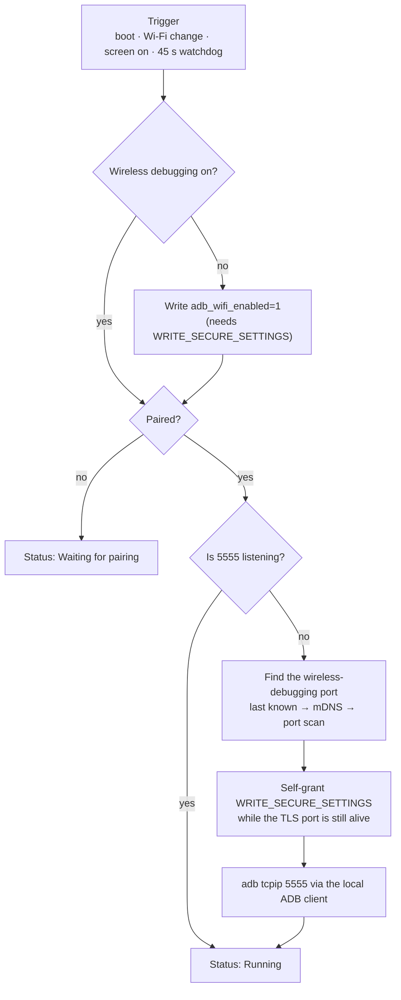

# OmniADB Host

**English** · [繁體中文](README.zh-TW.md)

> The phone-side half of OmniADB. Keeps wireless ADB pinned to port `5555` across
> reboots, Wi-Fi reconnects and sleep — **no root, no computer, no cable**.


<p align="center">
  
  
</p>

<p align="center">
  
  
</p>

---

## The problem

Android's *Wireless debugging* switch is **off after every reboot**. So the usual
setup — `adb connect <phone>:5555` to a phone that sits on a shelf — breaks the
moment the phone restarts, re-joins Wi-Fi on a new IP, or goes into deep sleep and
drops `adbd`. Someone has to walk over and toggle it again.

This app is that someone. It runs on the phone, watches the state, and repairs it.

## What it does

| | |
|---|---|
| **Boot recovery** | Listens for `BOOT_COMPLETED` / `LOCKED_BOOT_COMPLETED` (device-protected storage, so it works *before* first unlock) and brings ADB back by itself. |
| **Wi-Fi recovery** | A `NetworkCallback` fires on every reconnect / IP change and schedules a repair. |
| **Sleep recovery** | Screen-on and user-present broadcasts trigger a repair too. |
| **Watchdog** | Every 45 s it re-checks that `5555` is still listening and repairs if not. |
| **Pin to 5555** | Uses its own ADB client to run `tcpip:5555`, so the computer always connects to the same port. |
| **Self-granting** | Obtains `WRITE_SECURE_SETTINGS` through the local adbd shell (`pm grant`) — the app never asks you to run a command. |
| **One-time pairing** | Puts a pairing-code input box in the notification shade and finds the pairing port via mDNS, so you never type a port number. |
| **Auto-read pairing code** | An accessibility service reads the 6 digits from the system pairing dialog — only during the 10 minutes after you tap *Start pairing*. |
| **i18n** | Chinese (Traditional & Simplified) or English, chosen automatically from the system language. |

## How it works



Three details are worth knowing, because they are where naive implementations fail:

1. **Self-granting only works inside a narrow window.** `pm grant` runs through the
   local `adbd` shell, so a *live* adbd port must exist at that moment. Once
   `tcpip:5555` has been sent, the TLS port is gone and the handshake no longer
   works — so the grant is attempted **before** switching ports, and also at the very
   top of the repair routine (before any early `return`).
2. **The accessibility service is turned on by writing `Settings.Secure`.** Every
   deep link into the accessibility detail page is locked behind signature
   permissions, so no third-party app can open it. Writing
   `enabled_accessibility_services` + `accessibility_enabled=1` works on every OEM,
   and the app verifies the binding through `AccessibilityManager` instead of trusting
   the setting.
3. **Notification badges are per-channel.** The ongoing notification uses a channel
   created with `setShowBadge(false)`. Channel behaviour is frozen after creation, so
   the channel ID carries a version suffix (`adb_always_on_v2`).

## Install

### A. From the OmniADB desktop CLI (recommended)

```bash
python -m omniadb setup -s 192.168.1.192:5555 --build
```

The CLI builds and pushes this app, grants the permission, starts the service, pins
port 5555 and verifies the result.

### B. Plain `adb` (sideload)

```bash
adb install -r OmniADB-Host-1.1.0.apk
adb shell am start -n com.omniadb.host/.MainActivity   # starts the keep-alive service
```

Then finish the one-time pairing inside the app (see below). The app grants itself
`WRITE_SECURE_SETTINGS` during the first successful repair; if that fails, run:

```bash
adb shell pm grant com.omniadb.host android.permission.WRITE_SECURE_SETTINGS
```

### C. Build from source

```bash
git clone https://github.com/<you>/OmniADB-Host.git
cd OmniADB-Host
echo "sdk.dir=/path/to/Android/Sdk" > local.properties
./gradlew :app:assembleRelease
# → app/build/outputs/apk/release/app-release.apk
```

Requires JDK 17, Android SDK 35 (`compileSdk 35`, `minSdk 26`). The release build is
signed with the debug key so it can be sideloaded directly.

## First run: pair once

Pairing is the only step that needs a human, because Android only trusts a key that
was exchanged through the pairing dialog.

1. Open the app and tap **Start pairing**.
2. A notification appears with a text field — do not dismiss it.
3. On the phone go to **Developer options → Wireless debugging → Pair device with
   pairing code**.
4. If *auto-read pairing code* is on, the 6 digits are read and submitted for you.
   Otherwise pull down the notification shade and type them there. (The shade is an
   overlay, so the pairing dialog stays open — that matters, because the pairing
   server dies with the dialog.)
5. The app pairs, grants itself the permission, pins port 5555 and switches to
   **Running**.

From then on the phone needs no computer. Re-pairing is only necessary if the ADB
credential is revoked (e.g. *Revoke USB debugging authorizations*).

## Permissions

| Permission | Why |
|---|---|
| `WRITE_SECURE_SETTINGS` | Toggle `adb_wifi_enabled`, clear `adb_allowed_connection_time`, enable the accessibility service. Granted by the app itself through the local ADB shell. |
| `POST_NOTIFICATIONS` | The pairing input box and the keep-alive status both live in the notification shade. |
| `FOREGROUND_SERVICE` / `…_CONNECTED_DEVICE` | The keep-alive and pairing services must not be killed while idle. |
| `RECEIVE_BOOT_COMPLETED` | Start the service after a reboot. |
| `INTERNET`, `ACCESS_NETWORK_STATE`, `ACCESS_WIFI_STATE`, `CHANGE_WIFI_MULTICAST_STATE` | Talk to `127.0.0.1:adbd`, watch connectivity, discover the pairing port over mDNS. |
| `REQUEST_IGNORE_BATTERY_OPTIMIZATIONS` | Optional; OEM battery savers otherwise kill the watchdog. |
| `BIND_ACCESSIBILITY_SERVICE` | Read the pairing code from the system dialog. |

## Language support

The UI follows the **system language**; there is no in-app switch.

| System language | Shown |
|---|---|
| `zh-Hant` (zh-TW, zh-HK, zh-MO …) | Traditional Chinese |
| `zh-Hans` (zh-CN, zh-SG …) | Simplified Chinese |
| anything else (en, ja, de …) | English |

Implementation notes:

- `res/values/` is **English** (the default), `res/values-b+zh+Hant/` is Traditional
  and `res/values-b+zh+Hans/` is Simplified.
- The script qualifier is explicit on purpose. A bare `values-zh` folder is treated as
  *Simplified* by the platform, which makes Traditional Chinese devices fall all the
  way back to English. That bug is invisible in a screenshot and easy to ship.
- Status text is stored as **locale-independent codes** (`ok`, `attention`,
  `d_switch_port`, …) and translated only at render time, so switching the system
  language re-labels the existing state without restarting the service. The colour of
  the status line keys off the code, never off the translated string.
- Android walks the whole preferred-language list. If the phone's language list is
  `[ja-JP, zh-TW]`, the app shows Chinese — the user did list Chinese as a preference.

## Project layout

```
.
├── app/src/main/java/com/omniadb/host/
│   ├── MainActivity.java        # status screen, guide card, pairing entry points
│   ├── AdbKeepAliveService.java # watchdog + repair state machine
│   ├── PairingService.java      # mDNS pairing-port discovery + shade input box
│   ├── PairingReceiver.java     # RemoteInput → PairingService
│   ├── PairingCodeReader.java   # accessibility service (reads the 6 digits)
│   ├── AdbClient.java           # minimal ADB client (pair / shell / tcpip)
│   ├── BootReceiver.java        # BOOT_COMPLETED → start service
│   ├── Store.java               # device-protected SharedPreferences
│   ├── Msg.java                 # status codes ↔ localized strings
│   └── Net.java                 # LAN IPv4 lookup (skips VPN / cellular)
├── app/src/main/res/
│   ├── values/strings.xml           # English (default)
│   ├── values-b+zh+Hant/strings.xml # Traditional Chinese
│   ├── values-b+zh+Hans/strings.xml # Simplified Chinese
│   └── xml/accessibility_service_config.xml
└── docs/images/                 # screenshots
```

## Troubleshooting

| Symptom | Cause / fix |
|---|---|
| Status says **Permission lost** | The app was uninstalled and reinstalled (that clears `WRITE_SECURE_SETTINGS`). Turn on Wireless debugging and tap *Check and repair now*; or `adb shell pm grant com.omniadb.host android.permission.WRITE_SECURE_SETTINGS`. |
| *Start pairing* does nothing | Notification permission is off, so the input box never appears. The red banner at the top of the screen opens the right settings page. |
| Auto-read pairing code stays off | Android 13+ blocks *restricted settings* for sideloaded apps: **App info → ⋮ → Allow restricted settings**, then tap the button again. |
| Repairs stop after a while | OEM battery optimisation killed the process. Use *Add this app to the battery whitelist*. |
| `adb connect` works, reboot breaks it | Wireless debugging was on but the permission was missing at boot; open the app once so it can self-grant. |
| Wrong IP shown | The app prefers Wi-Fi/Ethernet over VPN interfaces; if a VPN still wins, connect to the Wi-Fi address shown under *Phone IP*. |

## Privacy

Everything happens on the device. The app talks to `127.0.0.1` only, keeps state in
device-protected `SharedPreferences`, and never uploads anything. The accessibility
service is scoped to `com.android.settings`, only runs within 10 minutes of an
explicit *Start pairing* tap, and the pairing code is never logged or stored.

## Compatibility

Tested on Samsung SM-G9810 (Android 13) and POCO 2412DPC0AG (Android 15).
`minSdk 26`, `targetSdk 34`. Any device where the local `adbd` accepts the app's key
should behave the same; OEM battery managers are the main source of variation.

## License

MIT — see [LICENSE](LICENSE). Not affiliated with Google or the Android Open Source
Project. *Wireless debugging* is a developer feature; use it on devices you own.
