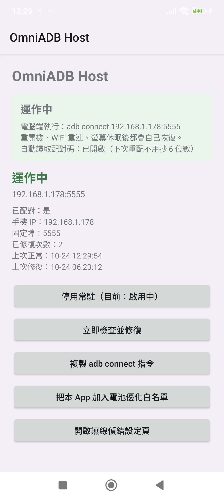
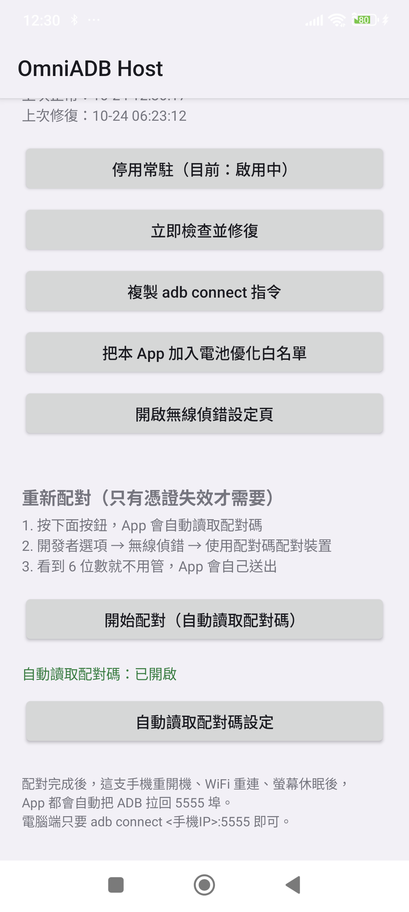
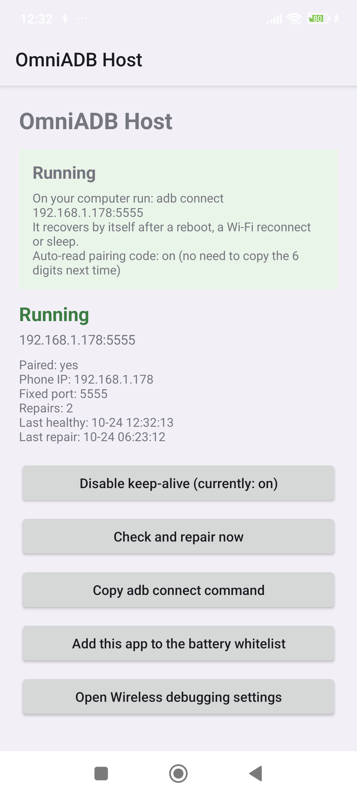
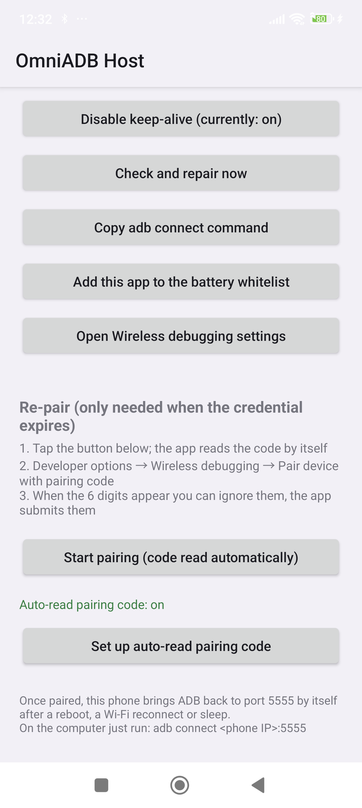
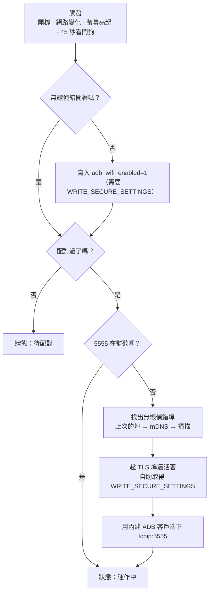

# OmniADB Host

[English](README.md) · **繁體中文**

> OmniADB 的手機端。把無線 ADB 釘在 `5555` 埠，讓它在**重開機、WiFi 重連、螢幕休眠**
> 之後自己回來 —— **免 root、不用電腦、不用插線**。


[](https://github.com/tokyoxpa3/OmniADB-Host/actions/workflows/build.yml)

<p align="center">
  
  
</p>

<p align="center">
  
  
</p>

---

## 要解決的問題

Android 的「無線偵錯」開關**每次重開機都會自己關掉**。所以「手機放在架上，電腦
`adb connect <手機>:5555`」這種用法，只要手機重開、換了 WiFi IP、或休眠太久把
`adbd` 斷掉，連線就沒了 —— 得有人走過去再打開一次。

這個 App 就是那個人。它住在手機上，盯著狀態，壞了自己修。

## 功能

| | |
|---|---|
| **開機自恢復** | 聽 `BOOT_COMPLETED` / `LOCKED_BOOT_COMPLETED`（狀態存在裝置保護儲存區，**第一次解鎖前**就能跑），自己把 ADB 拉回來。 |
| **WiFi 自恢復** | `NetworkCallback` 在每次重連 / 換 IP 時觸發修復。 |
| **休眠自恢復** | 螢幕亮起、使用者解鎖的廣播同樣會排程修復。 |
| **看門狗** | 每 45 秒確認 `5555` 還在監聽，不在就修。 |
| **釘住 5555** | 用內建 ADB 客戶端下 `tcpip:5555`，電腦端永遠連同一個埠。 |
| **自助授權** | 透過本機 adbd 的 shell 跑 `pm grant` 取得 `WRITE_SECURE_SETTINGS`，不需要你手動敲指令。 |
| **一次性配對** | 在通知欄放配對碼輸入框，並用 mDNS 找配對埠 —— 你**不用抄埠號**。 |
| **自動讀取配對碼** | 無障礙服務直接讀系統配對對話框上的 6 位數，且只在你按下「開始配對」後的 10 分鐘內動作。 |
| **多語系** | 中文（繁 / 簡）或英文，依系統語系自動切換。 |

## 運作原理



有三個地方是「照著直覺寫就會錯」的，值得先知道：

1. **自助授權只有一瞬間的窗口。** `pm grant` 是由本機 `adbd` fork 出來的 shell 執行的，
   所以**當下必須有一個活著的 adbd 埠**。一旦送出 `tcpip:5555`，TLS 埠就消失、
   握手也連不上 —— 所以授權一定要在**切埠之前**，而且必須放在修復流程最頂端
   （在任何提前 `return` 之前），否則「5555 已經開著」那條路會把唯一的機會吃掉。
2. **無障礙服務是用寫 `Settings.Secure` 打開的。** 所有進入無障礙詳情頁的深鏈都被
   簽名權限鎖死，第三方 App 根本叫不動。改成合併寫入
   `enabled_accessibility_services` + `accessibility_enabled=1`，各家 ROM 都適用；
   而且寫完要用 `AccessibilityManager` 驗證真的綁定，不能只看設定值。
3. **通知角標是頻道層級的。** 常駐通知用的頻道以 `setShowBadge(false)` 建立；頻道的
   行為欄位建立後就鎖死，所以頻道 ID 帶了版本後綴（`adb_always_on_v2`），換 ID 是唯一
   能讓既有安裝立刻生效的做法。

## 安裝

### A. 用 OmniADB 電腦端 CLI（推薦）

```bash
python -m omniadb setup -s 192.168.1.192:5555 --build
```

CLI 會建置並推送這個 App、授權、拉起常駐、釘埠、再驗證結果。

### B. 純 `adb`（側載）

```bash
adb install -r OmniADB-Host-1.1.1.apk
adb shell am start -n com.omniadb.host/.MainActivity   # 順便把常駐服務叫起來
```

接著在 App 內完成一次性配對（見下）。第一次修復成功時 App 會自助取得
`WRITE_SECURE_SETTINGS`；若失敗，補這一行：

```bash
adb shell pm grant com.omniadb.host android.permission.WRITE_SECURE_SETTINGS
```

### C. 自己建置

```bash
git clone https://github.com/<you>/OmniADB-Host.git
cd OmniADB-Host
echo "sdk.dir=/path/to/Android/Sdk" > local.properties
./gradlew :app:assembleRelease
# → app/build/outputs/apk/release/app-release.apk
```

需要 JDK 17、Android SDK 35（`compileSdk 35`、`minSdk 26`）。正式發佈的 APK 用一把固定的
release 金鑰簽章，金鑰檔放在 repo 外（路徑與密碼由 `keystore.properties` 指定，該檔已
`.gitignore`）；沒有那個檔案時會退回你本機的 debug 金鑰，所以自己建的 APK **蓋不過官方版**，
要裝得先卸載。

## 首次設定：配對一次

配對是唯一需要人動手的步驟 —— Android 只信任「透過配對對話框交換過」的金鑰。

1. 開 App，按「開始配對」。
2. 通知欄會出現一個帶輸入框的通知 —— 不要把它滑掉。
3. 手機進 **開發者選項 → 無線偵錯 → 使用配對碼配對裝置**。
4. 若「自動讀取配對碼」已開啟，6 位數會被自動讀取並送出；否則下拉通知欄自己輸入。
   （通知欄是覆蓋層，配對對話框不會被關掉 —— 這很重要，配對伺服器是跟著對話框存活的。）
5. App 完成配對、自助取得權限、釘住 5555，狀態轉為**運作中**。

之後這支手機就不需要電腦了。只有 ADB 憑證被撤銷（例如按了「撤銷 USB 偵錯授權」）
才需要重新配對。

## 權限

| 權限 | 用途 |
|---|---|
| `WRITE_SECURE_SETTINGS` | 切換 `adb_wifi_enabled`、清掉 `adb_allowed_connection_time`、開啟無障礙服務。由 App 自己透過本機 ADB shell 取得。 |
| `POST_NOTIFICATIONS` | 配對碼輸入框與常駐狀態都住在通知欄。 |
| `FOREGROUND_SERVICE` / `…_CONNECTED_DEVICE` | 常駐與配對服務閒置時不能被砍。 |
| `RECEIVE_BOOT_COMPLETED` | 重開機後把服務叫起來。 |
| `INTERNET`、`ACCESS_NETWORK_STATE`、`ACCESS_WIFI_STATE`、`CHANGE_WIFI_MULTICAST_STATE` | 連 `127.0.0.1:adbd`、監看連線、用 mDNS 找配對埠。 |
| `REQUEST_IGNORE_BATTERY_OPTIMIZATIONS` | 選用；不關電池優化的話，看門狗會被廠商省電機制殺掉。 |
| `BIND_ACCESSIBILITY_SERVICE` | 從系統對話框讀配對碼。 |

## 多語系

介面跟著**系統語系**走，App 內沒有切換開關。

| 系統語系 | 顯示 |
|---|---|
| `zh-Hant`（zh-TW、zh-HK、zh-MO…） | 繁體中文 |
| `zh-Hans`（zh-CN、zh-SG…） | 简体中文 |
| 其他（en、ja、de…） | English |

實作上有幾個細節：

- `res/values/` 是**英文**（預設），`res/values-b+zh+Hant/` 是繁體，
  `res/values-b+zh+Hans/` 是簡體。
- script 限定符是刻意寫死的。單純的 `values-zh` 資料夾會被平台當成**簡體**，
  結果繁體中文機反而一路回退到英文 —— 這個 bug 看截圖看不出來，很容易就上線。
- 狀態文字存的是**語系無關的代碼**（`ok`、`attention`、`d_switch_port`…），
  只在顯示的那一刻翻譯。所以切換系統語言時，服務不用重啟、狀態文字立刻跟著變；
  狀態列的顏色也只認代碼，不會因為翻譯而判斷錯。
- Android 會走完整個偏好語言清單。若手機的語言清單是 `[ja-JP, zh-TW]`，
  App 會顯示中文 —— 因為使用者確實把中文列為偏好語言。

## 專案結構

```
.
├── app/src/main/java/com/omniadb/host/
│   ├── MainActivity.java        # 狀態畫面、引導卡片、配對入口
│   ├── AdbKeepAliveService.java # 看門狗 + 修復狀態機
│   ├── PairingService.java      # mDNS 找配對埠 + 通知欄輸入框
│   ├── PairingReceiver.java     # RemoteInput → PairingService
│   ├── PairingCodeReader.java   # 無障礙服務（讀那 6 位數）
│   ├── AdbClient.java           # 精簡 ADB 客戶端（pair / shell / tcpip）
│   ├── BootReceiver.java        # BOOT_COMPLETED → 啟動服務
│   ├── Store.java               # 裝置保護儲存區的偏好設定
│   ├── Msg.java                 # 狀態代碼 ↔ 語系字串
│   └── Net.java                 # 取區域網路 IPv4（避開 VPN / 行動網路）
├── app/src/main/res/
│   ├── values/strings.xml           # 英文（預設）
│   ├── values-b+zh+Hant/strings.xml # 繁體中文
│   ├── values-b+zh+Hans/strings.xml # 簡體中文
│   └── xml/accessibility_service_config.xml
└── docs/images/                 # 截圖
```

## 疑難排解

| 症狀 | 原因／處理 |
|---|---|
| 狀態顯示**權限遺失** | 解除安裝再重裝會清掉 `WRITE_SECURE_SETTINGS`。開啟無線偵錯後按「立即檢查並修復」；或 `adb shell pm grant com.omniadb.host android.permission.WRITE_SECURE_SETTINGS`。 |
| 按「開始配對」沒反應 | 通知權限沒開，輸入框根本不會出現。畫面上方的紅色提示條會直接帶你到正確的設定頁。 |
| 自動讀取配對碼一直開不起來 | Android 13+ 對側載 App 有「受限制的設定」：**應用程式資訊 → ⋮ → 允許受限制的設定**，再按一次按鈕。 |
| 過一陣子就不再修復 | 被廠商省電機制殺了。用「把本 App 加入電池優化白名單」。 |
| `adb connect` 可以，但重開機就斷 | 開機時無線偵錯是開的、但權限沒補上；開一次 App 讓它自助授權。 |
| 顯示的 IP 不對 | App 會優先挑 WiFi／有線、避開 VPN；若還是被 VPN 蓋掉，連「手機 IP」那一行顯示的位址。 |

## 隱私

全部都在手機上完成。App 只連 `127.0.0.1`，狀態存在裝置保護儲存區，不上傳任何東西。
無障礙服務的範圍限定 `com.android.settings`，只在你按下「開始配對」後的 10 分鐘內運作，
配對碼本身不進日誌、不落盤。

## 相容性

實測 Samsung SM-G9810（Android 13）與 POCO 2412DPC0AG（Android 15）。
`minSdk 26`、`targetSdk 34`。只要本機 `adbd` 接受 App 的金鑰，行為應該一致；
主要變數來自各家 OEM 的省電策略。

## 授權

MIT，見 [LICENSE](LICENSE)。本專案與 Google／Android Open Source Project 無關。
「無線偵錯」是開發者功能，請用在你自己的裝置上。
